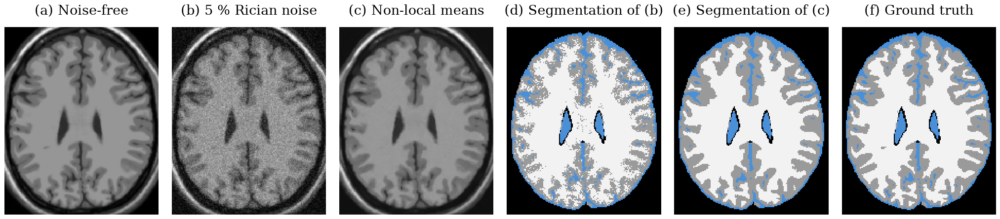

# GPU-Accelerated 3D MRI Denoising

Parallel 3D denoising of brain MRI (bilateral filter, non-local means,
Perona-Malik anisotropic diffusion) with sequential, OpenMP, and CUDA
implementations, plus a downstream tissue-segmentation stage (histogram
k-means, 3D morphology, and union-find connected-component labeling) that
measures whether denoising actually improves the analysis.

## Results at a glance

BrainWeb T1 phantom, 181×217×181 voxels, 5 % Rician noise. RTX 4050 Laptop
GPU and Ryzen 5 7535HS (6 cores / 12 threads). GPU times include transfers.

| Stage | Sequential | OpenMP, 12 threads | CUDA naive | CUDA optimized |
|---|--:|--:|--:|--:|
| Bilateral (r = 2) | 8.2 s | 1.2 s (6.8×) | 14 ms (575×) | 11 ms (718×) |
| Anisotropic diffusion (20 it.) | 5.9 s | 990 ms (6.0×) | 15 ms (388×) | 14 ms (415×) |
| Non-local means (7³ search, 3³ patch) | 510 s | 80 s (6.4×) | 457 ms (1,115×) | **205 ms (2,485×)** |
| Segmentation + CCL + cleanup | 585 ms | 223 ms (2.6×) | 20 ms (29×) | – |

Denoising improves the downstream segmentation: at 5 % noise the mean Dice
(CSF, GM, WM) rises from 0.885 on the noisy image to 0.944 after non-local
means (0.980 on the noise-free image), and the number of noise fragments drops
from 14,271 to 582.



Every OpenMP output is identical to the sequential one, every CUDA filter is
within 5.5e-6 of it, and the OpenMP and CUDA segmentations match the
sequential segmentation voxel for voxel. The raw data of every experiment is in
`results/final/*.csv` and the plots are in `results/figures/`.

### What the GPU versions do

- **Bilateral, `cuda-smem`**: block tile plus an r-voxel halo in shared memory,
  spatial weights in constant memory (1.5× over naive in kernel time).
- **Non-local means, `cuda-smem`**: tile plus an (S+P)-voxel halo, 2.4–2.7×
  over naive. **`cuda-sep`** adds separable box sums for the patch distance,
  O(P) instead of O(P³) per voxel: 7.7× over naive with 5×5×5 patches.
- **Diffusion, `cuda-fused`**: 2.5D z-marching with temporal blocking (K
  iterations pipelined through per-level 3-plane ring buffers, register
  prefetch of the next plane). Diffusion is bandwidth bound, so this only
  pays off once the volume no longer fits in L2: 1.14–1.19× from 192³ up. A
  plain 3D shared-memory tile (`cuda-smem`) is 2× *slower* than naive.
- **Segmentation**: shared-memory histogram, k-means thresholds, union-find
  connected-component labeling with atomicMin (Playne and Hawick). Labels are
  canonical (smallest voxel index per component), so every implementation
  produces bit-identical output.

## Repository layout

| Path | Contents |
|---|---|
| `src/cpu/` | sequential and OpenMP filters and segmentation (one source, `parallel` flag) |
| `src/cuda/` | CUDA kernels: naive, shared-memory, separable NLM, fused diffusion, segmentation and union-find CCL |
| `src/main.cpp`, `src/segment_main.cpp` | `denoise` and `segment` command-line drivers (one JSON line per run) |
| `include/` | volume type and I/O, filter and segmentation interfaces, CUDA helpers |
| `scripts/` | data preparation, correctness checks, benchmark sweeps, `experiments.py`, `make_figures.py`, `run_all.sh` |
| `results/final/` | CSV of every experiment |
| `results/figures/` | plots generated from those CSVs |

## Requirements

- Linux or WSL2 (developed on Ubuntu 24.04 under WSL2)
- CUDA toolkit 12.x, an NVIDIA GPU (developed on an RTX 4050 Laptop, sm_89)
- GCC with OpenMP, CMake >= 3.24
- Python 3.10+ for data preparation, evaluation, and plots

## Build

```bash
# If nvcc is not on PATH, point CMake at it:
cmake -B build -DCMAKE_CUDA_COMPILER=/path/to/cuda/bin/nvcc
cmake --build build -j
./build/denoise --device-info
```

For a different GPU, pass `-DCMAKE_CUDA_ARCHITECTURES=<sm>` (e.g. `86`).

## Python environment

```bash
python3 -m venv .venv          # if ensurepip is missing: --without-pip, then get-pip.py
.venv/bin/pip install -r requirements.txt
```

## Data

**Synthetic phantom** (no download; any size, used for problem-size and weak scaling):

```bash
.venv/bin/python scripts/prep_data.py synthetic --size 128 --out data/synth128
```

**BrainWeb** simulated T1 MRI, 181×217×181 at 1 mm. From
<https://brainweb.bic.mni.mcgill.ca/brainweb/> download, as *raw byte* files:

1. Simulated brain database → *Normal brain* → modality **T1**, slice thickness
   **1 mm**, noise **0%**, intensity non-uniformity **0%** (the clean reference).
2. Anatomical model → *Normal brain* → **discrete (crisp)** phantom (tissue labels).

The crisp phantom is on the *Anatomical Models* page, not in the simulator
form; its direct link is
<https://brainweb.bic.mni.mcgill.ca/cgi/brainweb1?alias=phantom_1.0mm_normal_crisp&download=1>.
Choose *raw byte (unsigned)* and *gnuzip*. Then, with both `.rawb.gz` files in
one folder:

```bash
scripts/import_brainweb.sh /mnt/c/Users/<you>/Downloads
```

This copies them into `data/raw`, checks their sizes, and runs
`prep_data.py brainweb` to build `data/brainweb` (`clean.vol`, `labels.vol`,
and `noisy_<p>.vol` for Rician noise of 3, 5, 7, 9 % of the maximum intensity,
fixed seed). `scripts/preview.py` renders mid-slices of any volumes.

## Reproducing the results

```bash
scripts/run_all.sh
```

builds, runs the correctness checks, runs every experiment (about 1.5 hours;
finished experiments are skipped on a rerun), and regenerates the figures. The
steps can also be run on their own:

```bash
.venv/bin/python scripts/experiments.py --list      # what each experiment measures
.venv/bin/python scripts/experiments.py quality     # rerun one experiment
.venv/bin/python scripts/make_figures.py
```

Configuration: build options are in `CMakeLists.txt`, Python dependencies in
`requirements.txt`, and every experiment's parameters (inputs, thread counts,
block shapes, filter parameter sweeps, noise levels, repetitions) are defined
in the experiment functions of `scripts/experiments.py`.

## Running the tools

**Denoising**

```bash
./build/denoise --algo nlm --impl cuda-smem --search 3 --patch 1 --h 0.04 \
    -i data/brainweb/noisy_5.vol -o results/nlm.vol
```

`--impl` is `seq`, `omp` (`--threads N`), `cuda` (naive GPU), or `cuda-smem`
(shared-memory tile with halo) for every filter. NLM also has `cuda-sep`
(shared memory plus separable patch distances), and diffusion has `cuda-fused`
(2.5D z-marching that runs `--fuse K` iterations per launch, default 2, on a
2D block, default 32,16,1). Run `./build/denoise` without arguments for all
options.

**Segmentation**

```bash
./build/segment --impl cuda -i results/nlm.vol --mask data/brainweb/labels.vol -o results/seg.vol
./build/segment --mode ccl --impl omp -i results/seg.vol      # labeling alone
```

The brain mask is `labels > 0`; Dice is computed against the same labels.
`--open` enables the morphological opening, `--min-size N` sets the fragment
size removed by the cleanup (default 10, 0 = off).

Each run of either tool prints one JSON line with the median time over
`--reps` runs (GPU runs exclude a warm-up run and split host-to-device,
kernel, and device-to-host time).

**Checks and sweeps**

| Script | What it does |
|---|---|
| `scripts/smoke_test.sh` | every implementation on a small volume, compared with sequential |
| `scripts/check_variants.sh` | optimized bilateral/diffusion over 56 block/fusion/chunk configurations vs OpenMP |
| `scripts/check_segment.sh` | OpenMP and CUDA segmentation and CCL labels vs sequential, exact |
| `scripts/nlm_variants.sh`, `nlm_block_sweep.sh` | NLM GPU versions and block shapes |
| `scripts/gpu_ladder.sh`, `diffusion_sizes.sh` | bilateral/diffusion block shapes, fusion depth, problem size |
| `scripts/tdr_check.sh` | checks that long NLM launches stay under the Windows/WSL2 kernel watchdog |
| `scripts/evaluate.py` | PSNR/SSIM (whole volume and tissue) and max difference from a reference |

## File format

`.vol` files are a 16-byte header (`VOLF` or `VOLB` magic, then `int32 nx, ny, nz`)
followed by float32 or uint8 voxels, x fastest. See `include/volume.hpp` and
`scripts/volio.py`.

## Benchmarking notes

- Run plugged in and close other GPU-heavy applications; laptop clocks
  throttle under sustained load. Results are the median of several runs.
- On Windows/WSL2 the display driver kills kernels that run longer than
  about 2 s (TDR), so long NLM launches are split into 16-plane slabs.
